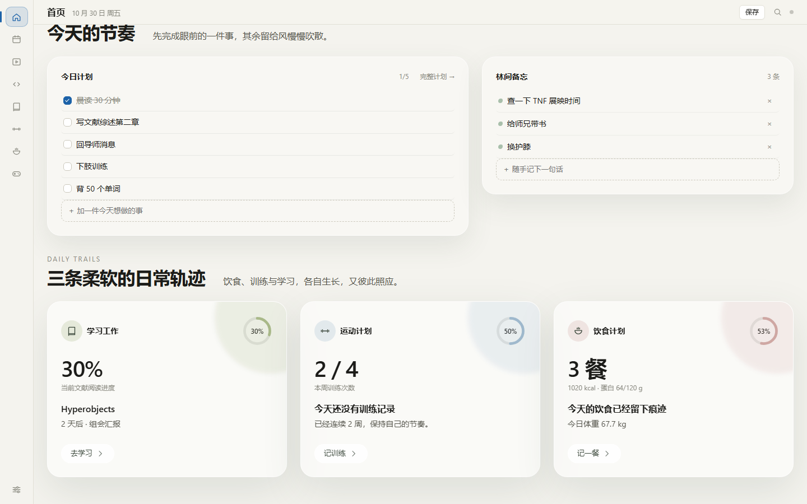

# 个人工作生活台

一个只在本机浏览器里运行的个人管理应用。九个模块——首页、今日计划、自媒体、开发工作、学习工作、运动计划、饮食计划、游戏娱乐、数据与设置——每个模块按自己的场景设计形态，不共用同一套任务列表。

- 不联网、不登录、不上传、不构建，所有数据留在你自己的浏览器里
- 首页采用「晨雾草丘」沉浸式自然风：SVG 绘制的草丘湖泊 hero、毛玻璃卡片、低饱和配色
- 105 条自动化测试覆盖数据层、页面逻辑与设计规范




## 快速开始

Windows 下双击项目根目录的 `start.cmd`，浏览器会自动打开。

```
http://127.0.0.1:8787/
```

如果窗口一闪而过，多数情况是服务已在运行（脚本会直接唤起浏览器后退出）。手动打开上面的地址即可。

**两个不能踩的点：**

1. **不要双击 `index.html`。** `file://` 协议下 Chrome 不开放 IndexedDB，数据存不进去，页面会静默失效。
2. **不要改用 `localhost:8787`。** IndexedDB 按「协议 + 域名 + 端口」隔离，`localhost` 和 `127.0.0.1` 在浏览器眼里是两个不同站点，换着访问会出现「数据不见了」的假象。

服务是 40 行的零依赖静态服务器（`serve.js`），优先用 Node，找不到则回退 Python。端口固定 8787——换端口等于换一个空数据库。

## 九个模块

| 模块 | 做什么 |
|---|---|
| 首页 | 今日完成度、今日计划、快速备忘，饮食 / 运动 / 学习三张入口卡 |
| 今日计划 | 时间块排序、从模块拉取任务、负荷条、昨日遗留一键带入 |
| 自媒体 | 三列看板（想法 / 撰写中 / 已发布），拖拽改状态，发布数据可视化 |
| 开发工作 | 项目 → 任务三组 / Bug 表 / 版本里程碑 / 工作日志 |
| 学习工作 | 14 天日程条、文献状态流转、输出物全屏编辑器 |
| 运动计划 | 训练卡（组 / 次 / 重量 / RPE）、动作库、PR 曲线、训练日历 |
| 饮食计划 | 四餐分栏、食物库搜索与份量换算、营养条、体重曲线、饮食日历 |
| 游戏娱乐 | 心愿清单，钉本周最多三条，随机只抽「想做」 |
| 数据与设置 | 导出导入、分模块清空、目标设置、外观、词库管理 |

## 数据存在哪里

存在浏览器的 IndexedDB 里，库名 `lifeapp`，18 个对象仓库。所有写入串行走队列，字段自动补 `id / createdAt / updatedAt`。

- **备份**：设置页「导出」会下载一份 JSON，含全部数据与版本号
- **恢复**：导入时选择「合并」（按 `updatedAt` 较新者胜）或「替换」（替换前会自动再下载一次备份）
- **校验**：导入文件逐项校验，结构不符整份拒绝，不会写坏半个库

**注意**：数据与 Git 无关。清浏览器缓存、换电脑、换浏览器都会丢，跨机迁移靠导出的 JSON。

## 键盘

| 键 | 作用 |
|---|---|
| `Ctrl / Cmd + K` | 全局搜索（跨五个模块的标题） |
| `Ctrl / Cmd + S` | 立即保存（把防抖中的改动马上写库） |
| `Ctrl / Cmd + Z` | 撤销上一次删除 |
| `1` – `8` | 切换模块 |
| `N` | 聚焦当前页的新建输入框 |
| `Esc` | 关闭抽屉 / 弹窗，撤回行内编辑 |

## 技术选型

原生 ES2022 + ES Modules，**运行时零依赖、零 CDN、零构建**。界面用手写的 DOM 辅助函数拼装，图标是内联 SVG symbol，配色全部走 CSS 变量（深浅双主题）。

`node_modules` 里只有三个测试与截图用的包：`jsdom`、`fake-indexeddb`、`puppeteer-core`。它们在运行时完全不参与加载。

## 目录结构

```
index.html            应用外壳、内联 SVG 图标
start.cmd             本机启动脚本
serve.js              零依赖静态服务器
css/
  tokens.css          设计令牌：颜色、间距、圆角、字号（深浅两套）
  base.css            重置、布局骨架、字体
  components.css      按钮、输入、卡片、抽屉、弹窗等通用件
  pages.css           各页专有布局
js/
  app.js              引导、路由分发、全局键盘
  core/               数据层：schema db router dates settings save backup …
  ui/                 交互件：el inline toast drawer modal chart search
  views/              九个页面
tests/                105 条测试（node --test + jsdom + fake-indexeddb）
PRD.md                需求文档，含 38 条验收标准
DEVPLAN.md            开发计划与阶段划分
design/ui-spec.html   页面结构线框图
docs/                 验收清单与截图
```

## 测试

```bash
npm install
npm test
```

测试脚本固定 `--test-concurrency=2`——并发跑满会把内存挤爆导致子进程被杀。

## 已知边界

- 版本里程碑只显示已挂任务数，没有勾选界面
- `N` 键在运动、学习两页聚焦到页面第一个输入框，而不是直接打开新建抽屉
- 字体 Manrope / Inter / Instrument Serif 若本机未安装会回退系统中的文字体，版式不塌
